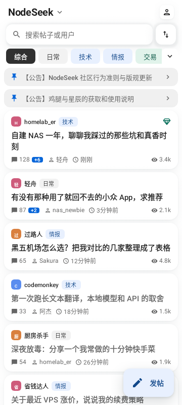
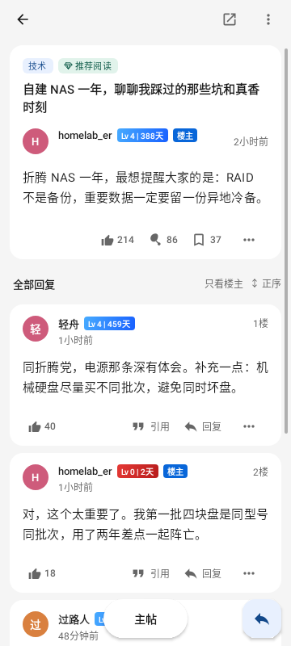
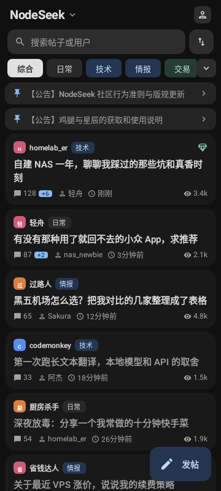
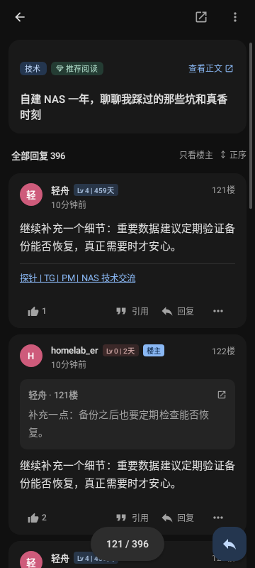

<div align="center">

# Nodyssey

**一个为 NodeSeek 而生的开源客户端**

舒适地阅读、交流与探索。在支持的网络环境下，借助内置 DoH 与 ECH，**不配置代理也能尝试直连 NodeSeek**。

[下载 Android / iOS](https://github.com/weishiair/nodyssey/releases/latest) · [功能与更新](CHANGELOG.md) · [反馈问题](https://github.com/weishiair/nodyssey/issues) · [Telegram 交流群](https://t.me/+JGCIMJmPrj0wZGVh)

[](https://github.com/weishiair/nodyssey/releases)
[](https://github.com/weishiair/nodyssey/releases)
[](https://github.com/weishiair/nodyssey/actions/workflows/ci.yml)
[](LICENSE)

</div>

> 本项目是 [Nodyssey](https://github.com/5151561/nodyssey) 的非官方分支，与 NodeSeek 官方无关。保留原项目署名，并遵循 GPL-3.0 许可证。

## 界面预览

| 帖子列表 · 浅色 | 连续阅读 · 浅色 | 帖子列表 · 深色 | 回复卡片 · 深色 |
| :---: | :---: | :---: | :---: |
|  |  |  |  |

<sub>以上为 Android Compose 界面渲染图，使用示例帖子和账号数据，并非实机或 iOS 截图；实际界面可能因设备、设置与版本而有所不同。</sub>

## 免代理直连，少一点折腾

Nodyssey 内置加密 DNS（DoH）和 ECH 支持：DoH 通过加密连接解析域名，ECH 在服务端及客户端条件满足时保护 TLS 握手中的域名信息。配合内置的 **Weishiair DoH（ECH）**，可以在部分网络中尝试不使用代理访问 NodeSeek。

**开始使用：**

1. 打开 **设置 → 加密 DNS**（网络一栏），启用加密 DNS。
2. 选择 **Weishiair DoH（ECH）** 并保存；首次启用时该服务是默认选择，已有用户的设置会保留。
3. 如要尝试直连，在 **设置 → 代理**（网络一栏） 中确认未启用论坛代理；遇到问题可以打开 **网络自检** 查看连接状态。

> **连接能力取决于网络环境。** DoH/ECH 不是 VPN，也不保证所有网络都能直连；目标 IP 不可达等问题仍可能导致连接失败。应用内代理开启时，走代理的请求不会使用上述直连路径。网页登录和人机验证使用系统 WebView，与原生请求的网络链路不同，不能保证同样使用 DoH/ECH。
>
> Android 8–16 使用应用内的 ECH TLS 实现，Android 17 及以上使用系统实现。iOS 原生请求也支持相应的 DoH/ECH 链路，实际效果仍取决于设备与网络。详见 [分支网络说明](docs/ech-fork.md)和 [iOS 网络实现](docs/ios-doh-ech.md)。

## 让阅读更舒服

- **连续阅读**：上下翻页接续回复、楼层定位、记录阅读位置；想回到正文时可以快速返回。
- **更自在的排版**：回复可选通栏、轻卡片或官方原版，支持引用、签名档和楼主标记；作者等级与注册天数也可按需关闭。
- **随心换肤**：纯白与中性深色模式，加上多套预设和自定义主题；阅读字号可以调整。
- **完整的论坛体验**：浏览、发帖、回复、收藏、投票、签到，以及通知、私信、关注和用户空间。
- **为日常使用准备**：离线缓存、浏览历史、图片预览与上传、网络自检，以及 NodeSeek / DeepFlood 站点切换。

部分功能和平台支持可能不同，请以应用内实际界面为准。

## 下载与安装

前往 [GitHub Releases](https://github.com/weishiair/nodyssey/releases/latest) 下载最新正式版：

| 平台 | 文件 | 安装说明 |
| --- | --- | --- |
| Android 8.0+ | `nodyssey-v版本号.apk` | 使用本分支既有签名；可覆盖升级本分支旧版，保留数据。 |
| iOS | `nodyssey-v版本号.ipa` | **未签名**，需使用自己的签名方式安装；iOS 功能与网络体验可能和 Android 不同。 |
| 开发排障 | `mapping-v版本号.txt` | Android 崩溃堆栈反混淆用的对照表，普通用户无需下载。 |

应用内更新仅跟随本分支，不会替换为上游版本。历史版本和更新记录见 [Releases](https://github.com/weishiair/nodyssey/releases) 与 [CHANGELOG.md](CHANGELOG.md)。

## 构建与参与

Android 构建需要 JDK 21 和 Android SDK 37：

```bash
./gradlew :app:assembleDebug
```

模块和架构见 [docs/architecture.md](docs/architecture.md) 与 [docs/README.md](docs/README.md)；iOS 构建流程见 [docs/ios-build.md](docs/ios-build.md)。

- 使用中遇到问题？在 [Issues](https://github.com/weishiair/nodyssey/issues/new/choose) 反馈，附上版本、设备和必要的错误信息；**不要公开密码、Cookie 或其他敏感信息**。
- 欢迎加入 [Telegram 交流群](https://t.me/+JGCIMJmPrj0wZGVh)讨论使用体验和更新。
- 提交代码前请阅读 [CONTRIBUTING.md](CONTRIBUTING.md)。
- 也可以访问项目的 [介绍页](https://weishiair.github.io/nodyssey/)。

## 致谢与许可证

- [5151561/nodyssey](https://github.com/5151561/nodyssey)（GPL-3.0）：本分支基于原项目开发。
- [tyrad/nodeseek](https://github.com/tyrad/nodeseek)（MIT）：iOS 客户端和站点结构的参考。
- [mrzhiin/seekmate](https://github.com/mrzhiin/seekmate)（MIT）：部分 JSON 端点的发现来源。
- [Woodll / Nodeseek Pro](https://greasyfork.org/zh-CN/scripts/567109-nodeseek-pro)（GPL-3.0）：作者等级与注册天数标签、等级渐变配色的参考。
- [edge-smart-doh](https://github.com/1molchuan/edge-smart-doh)：内置 DoH 服务的基础。

本项目遵循 [GPL-3.0](LICENSE) 许可证，感谢所有上游项目与贡献者。
